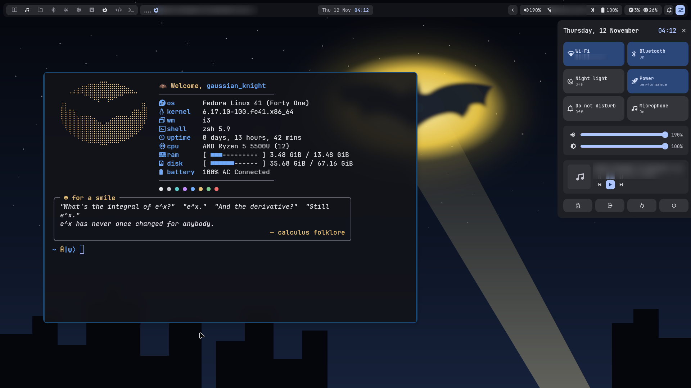
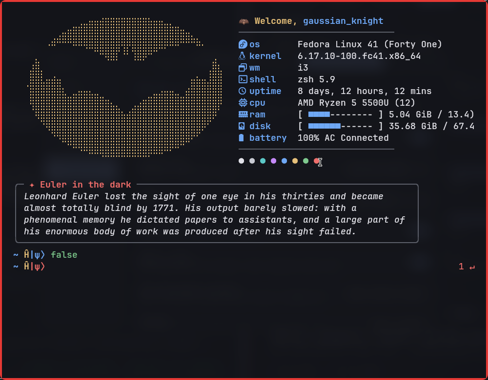
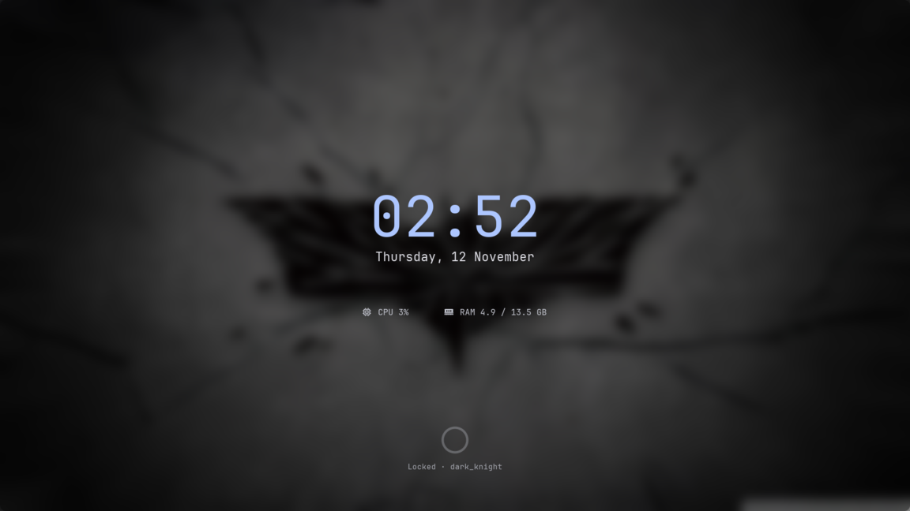
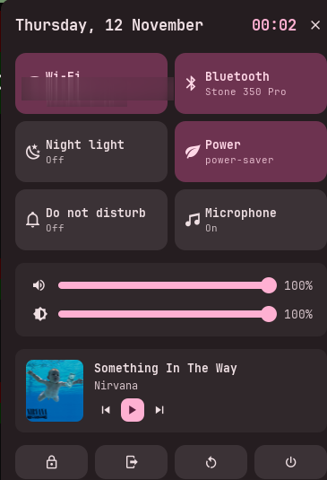
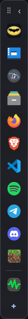
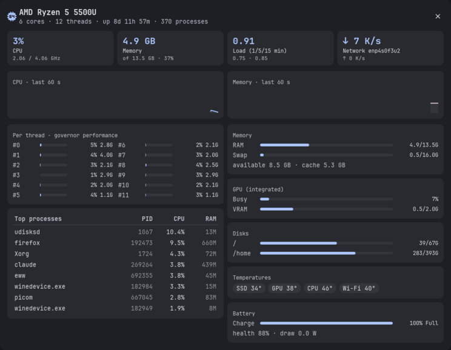

# gaussian_knight's i3 rice

Fedora · i3 · X11 · eww bar · picom · kitty · zsh · rofi · dunst · i3lock-color · Thunar

**One** blue Material palette, **one** font (JetBrainsMono Nerd Font), **one** corner radius (12 px) and **one** spacing scale.
All of it comes from `theme/`, and one script recolors everything.



| | |
|---|---|
|  |  |
|   |  |

More in [`docs/screenshots/`](docs/screenshots).

## Highlights

- **eww bar + popups:** quick settings (Wi-Fi, Bluetooth, night light, power profile, DND, mic, volume, brightness, music), network,
  notifications, calendar with reminders, and a full **system monitor**. Everything is event-driven, with no polling while popups are closed.
- **Bat-signal terminal:** a fastfetch greeter with a random quote, joke or short story (mathematicians, physicists, philosophers), and the ket prompt `Ĥ|ψ⟩`.
- **Terminal Studio:** a GUI for kitty's font, opacity, colors, prompt and startup art.
- **Rice Dock:** a floating, collapsible launcher, where ＋ adds apps or shell aliases.
- **Media popup:** right-click the bar's music pill to see every player (Spotify, Firefox, …) with its own controls, and click one to show it in the bar. The bar sticks to the player you used, so pausing Spotify no longer jumps to some paused Firefox tab.
- **Rice Tube:** YouTube in its own window, not a browser tab. It tiles next to your terminals like kitty, Super+Shift+Enter shows/hides it while the video keeps playing, and links to other sites open in your browser. (`local-share/rice-apps/rice-tube.py`, toggle `i3/scripts/tube.sh`)
- **Random red/blue window borders** (picom shader), smooth floating, autotiling, a dropdown terminal.
- **Lock screen:** i3lock-color with a blurred wallpaper, clock and music, plus idle and before-suspend locking.
- **Clipboard history**, battery/temperature alerts, a wallpaper picker (desktop + lock screen), a power menu, and a key cheat sheet generated from the live i3 config (Super+F1).

## Easiest: install single apps

[`apps/`](apps) has self-contained kits with their own README and `install.sh` (no sudo):
[clipboard history](apps/clipboard) · [floating dock](apps/dock) · [system monitor](apps/sysmon).

## Whole rice

| Folder | Goes to |
|---|---|
| `i3/` | `~/.config/i3/` (my original config plus the rice additions in `[rice]` blocks; take what you like) |
| `eww/`, `theme/`, `picom/`, `kitty/`, `rofi/`, `dunst/`, `lockscreen/`, `fastfetch/`, `terminal-greeter/`, `terminal-studio/`, `rice-dock/`, `rice-alerts/`, `gammastep/` | `~/.config/<same name>/` |
| `gtk/`, `qt/` | `~/.config/gtk-3.0`, `gtk-4.0`, `~/.gtkrc-2.0`, `~/.config/qt5ct`, `qt6ct` |
| `thunar/` | `~/.config/Thunar/` + xfconf |
| `tmux/` | `~/.tmux.conf` |
| `zsh/` | `ket.zsh-theme` → `~/.oh-my-zsh/custom/themes/`; `rice.zsh` → source it from your `.zshrc`; `.profile` → `~` |
| `local-share/rice-apps/` | `~/.local/share/rice-apps/` (Terminal Studio, Rice Dock, clipboard, alerts) |
| `bin/` | `~/.local/bin/` |
| `applications/` | `~/.local/share/applications/` |
| `wallpapers/` | `~/Pictures/Wallpapers/` |

```bash
# Fedora packages
sudo dnf install i3 picom kitty zsh tmux rofi dunst nitrogen thunar thunar-archive-plugin thunar-volman tumbler \
  ffmpegthumbnailer xarchiver gammastep power-profiles-daemon playerctl pamixer brightnessctl xss-lock xclip \
  materia-gtk-theme papirus-icon-theme gtk-murrine-engine qt5ct qt6ct fastfetch zoxide python3-i3ipc python3-xlib \
  flameshot jq ImageMagick librsvg2-tools
# built from source: eww (X11 build), i3lock-color; matugen via `cargo install matugen` (optional, wallpaper → palette)
```

Some files contain my home path. After copying, replace it with yours:
```bash
grep -rl /home/dark_knight ~/.config ~/.local/share/applications 2>/dev/null | xargs -r sed -i "s|/home/dark_knight|$HOME|g"
```
Then run `~/.config/theme/scripts/apply-theme.sh` (it renders every color file) and `i3-msg restart`.

**Before adding the i3 lines, check them against your own bindings.** My rice only added keys that were free in *my* config.

## How to…

- **Change the colors:** edit `~/.config/theme/theme.conf`. `COLOR_MODE=fixed` uses `palettes/fixed.json` (blue); `COLOR_MODE=wallpaper` generates a palette from the wallpaper with matugen. Then run `apply-theme.sh`.
- **Change the wallpaper:** Super+Shift+W, or right-click an image in Thunar → *Set as wallpaper*.
- **Change the terminal look:** run Terminal Studio (`terminal-studio`, or from the dock).
- **Add quotes or stories to new terminals:** add `.txt` files to `~/.config/terminal-greeter/library/` (entries separated by a `%` line).
- **Change the lock screen:** edit `~/.config/lockscreen/lock.conf`; `lock.sh --preview` shows it without locking.
- **Add a shortcut:** add a `bindsym`, then run `~/.config/i3/scripts/gen-popup-mode.py && i3-msg reload`, so it also works while a popup is open.

All shortcuts: [`docs/i3-shortcuts.txt`](docs/i3-shortcuts.txt).

## Also by me

[**gaussian_keep**](https://github.com/knight-dwell/gaussian-keep-app): a Keep-like notebook for science people (LaTeX scratchbook, planner, journal, reminders) for Linux and Android.

## License

MIT, see [LICENSE](LICENSE). The wallpaper is generated, and the quotes in `terminal-greeter/library/` belong to the people they're attributed to.
