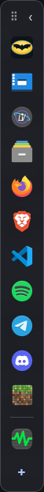

# Rice Dock: floating, collapsible app launcher



A small floating dock for X11 (made for i3).

- **Drag** it anywhere by the grip (⠿) at the top. It remembers where you left it.
- The **chevron** collapses it into a slim tab on the nearest screen edge. Click the tab to bring it back.
- **Click** an app to start it. **Right-click** an app to edit, move or remove it.
- **＋** adds an app: pick an installed one, or type any command or **zsh alias** (e.g. `vim`) and choose whether it runs in a terminal.
- The **chart icon** opens the system monitor (install the `sysmon` kit next to this one).
- `rice-dock` again (or **Super+O**) toggles collapsed/expanded.

The colors follow Material dark (blue) out of the box.

## Files

| File | What it is |
|---|---|
| `rice-dock.py` | the dock (Python + GTK 3) |
| `ricetheme.py` | its color theme (Material dark by default) |
| `rice-dock` | the command |
| `i3-snippet.conf` | i3 lines: float it on every workspace, start at login, Super+O |
| `install.sh` | copies the files into place (no sudo) |

Your app list ends up in `~/.config/rice-dock/apps.json` (written the first time you start the dock; you can edit it by hand).

## Install

```sh
# needs: python3-gobject (GTK 3); kitty + zsh for apps marked "runs in a terminal"
#   Fedora:  sudo dnf install python3-gobject gtk3 kitty zsh
#   Ubuntu:  sudo apt install python3-gi gir1.2-gtk-3.0 kitty zsh
#   Arch:    sudo pacman -S python-gobject gtk3 kitty zsh
./install.sh
```

Then add `i3-snippet.conf` to `~/.config/i3/config` (check that Super+O isn't already used) and press Super+Shift+R.
A Nerd Font (e.g. JetBrainsMono Nerd Font) makes the small icons look right.
