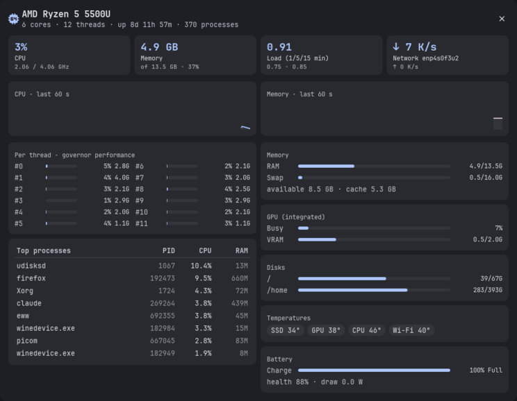

# System monitor (eww window)



A floating system-monitor window: CPU model, frequency and load, per-thread usage, 60-second CPU and memory graphs,
memory and swap, GPU, disks, temperatures, battery, network speed and the top processes.
It refreshes every 2 s, **only while it is open**, so it costs nothing when it's closed.

It runs as its **own** small [eww](https://github.com/elkowar/eww) setup in `~/.config/rice-sysmon`, so it works
next to any bar (polybar, i3bar, your own eww bar).

## Files

| File | What it is |
|---|---|
| `eww.yuck`, `eww.scss`, `_colors.scss` | the window and its look (colors in `_colors.scss`) |
| `sysmon.py` | collects the numbers (reads /proc and /sys, nothing to install) |
| `toggle.sh` | open/close the window |
| `rice-sysmon` | the command (`rice-sysmon`, `rice-sysmon open`, `rice-sysmon close`) |
| `i3-snippet.conf` | i3 lines: float + center the window, Super+M |
| `install.sh` | copies the files into place (no sudo) |

## Install

1. Install **eww** (version 0.5 or newer, X11 build). It isn't in most distro repos, so build it with Rust:
   ```sh
   git clone https://github.com/elkowar/eww && cd eww
   cargo build --release --no-default-features --features x11
   install -m 755 target/release/eww ~/.local/bin/eww
   ```
   (needs `gtk3-devel` / `libgtk-3-dev` and `rust`/`cargo`; Arch users can use the AUR package `eww`.)
2. Install a Nerd Font such as **JetBrainsMono Nerd Font** (the icons use it).
3. `./install.sh`, then add `i3-snippet.conf` to `~/.config/i3/config` (check that Super+M is free) and press Super+Shift+R.

Then press **Super+M** (or run `rice-sysmon`). Close it with ✕ or Super+M again. Drag it with Super + mouse.
